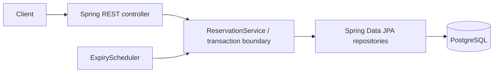

# Design note — Ticket Reservation Service

## Components and request flow

HTTP validation and status codes live in `api/`; business transitions in `service/`; persistence in `repo/`; tables are created by Flyway. Spring Boot Actuator supplies health information, surfaced at `/health`.

## Data model

- `events`: immutable capacity, and `available_seats`, `held_seats`, `booked_seats` counters. A DB CHECK constraint enforces `available + held + booked = total` and nonnegative counts.
- `holds`: customer, event, quantity, expiry timestamp and status (`ACTIVE`, `CONFIRMED`, `CANCELLED`, `EXPIRED`).
- `bookings`: immutable confirmation record, unique `hold_id` for database-level duplicate prevention.

The brief asks for *N seats* rather than a numbered seat map. This solution allocates interchangeable inventory units, so it cannot double-book an individually identified seat; numbered-seat selection would need a separate `seats` table and unique allocation constraints.

## Concurrency and correctness

For all inventory-changing operations, lock the `events` row with PostgreSQL `SELECT ... FOR UPDATE` inside a single transaction. Only then expire stale holds, check the per-customer active quantity and remaining capacity, and update the counters/hold/booking. This serializes competing operations for the same event across **multiple application instances**, not merely within one JVM. Transaction rollback restores all changes if a step fails. Booking `hold_id` is also UNIQUE.

The invariant is checked in PostgreSQL, not just in Java. The 6-seat rule is enforced across *all currently active holds* of a customer for an event, not merely per request. Since event locking serializes hold creation and expiry, concurrent requests cannot bypass it.

Why not Java `synchronized`? It only protects one JVM. Why not optimistic locking? Under a hot last-seat rush, it causes high retry rates; pessimistic locking makes the ordering explicit. Trade-off: one hot event becomes a throughput bottleneck; transactions must be short.

## Confirm, cancel, and expiration

A confirmation acquires the event lock before inspecting the authoritative hold status. If `ACTIVE` and unexpired, it changes to `CONFIRMED`, transfers held inventory to booked, and inserts a booking. Repeated confirmation returns the existing booking; a unique hold-to-booking relation protects against duplicates. A cancelled hold cannot be confirmed. An expired hold returns HTTP 410.

A hold expires when `expires_at <= now` (UTC). Expiration is processed lazily on event operations and by a scheduled sweep that finds events with expired holds. Each sweep takes the **same event lock**; simultaneous sweeps on two instances may wait/recheck, but cannot double-release. The sweep is eventually consistent; the confirm path checks expiry even when the sweep is delayed. Note that a failed confirm transaction rolls back any lazy release performed in that transaction; the periodic sweep or next successful event operation persists release. This is an intentional simple trade-off.

## Scaling to 100× and future work

The first bottleneck is contention on one event row, then database connection pool pressure. Add rate limits and backpressure, measure lock wait time, tune connection pools, and partition high-demand events into independently lockable inventory buckets (while preserving a hard total-capacity invariant). A queue could smooth extreme bursts. For expiration at scale, process bounded batches and coordinate workers using `SKIP LOCKED` or a job queue instead of scanning all expired event IDs. Cache only non-authoritative reads; never use cache as the source of inventory truth.

With another week: implement auth/customer identity, event start-time booking policy, pagination, OpenAPI examples, integration tests across two running API instances, clock-controlled expiry tests, structured request correlation IDs, metrics/tracing, and more robust background sweep recovery.
